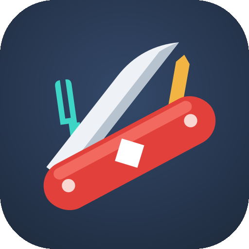

<p align="center"></p>

# Navaja ◆

App **Android** navaja suiza de visualización: abre **GAG · SDJF · SVG · STL · OBJ · PDF** en un solo lugar, y además **escanea objetos en 3D** con la cámara (con escenario impreso o desde un video). Todo corre en el dispositivo con las librerías empaquetadas en el APK: **funciona sin internet**. También trae un **afinador de guitarra y violín**, un **escáner de red local**, un **modo ingeniería de red móvil**, un **marcador de ubicaciones**, **brújula y nivel**, **pulso por cámara** y una **pantonera** para medir colores y texturas. El visor no pide permisos; la cámara y el micrófono sólo se piden al entrar en el escáner, la pantonera o el afinador.

## 🏠 Pantalla de inicio

Al abrir la app aparece un panel con las funciones: **Visor de archivos**, **Escáner 3D**, **Escáner 3D desde video**, **Afinador**, **Red local**, **Red móvil**, **Marcador**, **Brújula y nivel**, **Pulso**, **Pantonera** (en la versión web las nativas se muestran como «sólo en la app Android»). El botón **⌂ Inicio** de la cabecera y el botón *Atrás* de Android vuelven a este panel.

## ✨ Qué abre

| Formato | Cómo lo muestra |
|---|---|
| `.gag` / `.sdjf` (AlmaGag) | Vista previa rápida del diagrama (nodos, conexiones, colores, flechas, iconos embebidos) + resumen del archivo. El render oficial sigue siendo el SVG que emite el motor AlmaGag. |
| `.svg` | Render fiel con pan y zoom (ideal para los SVG generados por AlmaGag). |
| `.stl` / `.obj` | Vista 3D con órbita táctil y panel de pieza para impresión 3D: triángulos, dimensiones en mm, volumen, área y peso estimado en PLA. |
| `.pdf` | Visor paginado con zoom y carga perezosa de páginas. |

## 🎻 Afinador (botón «Afinador»)

Afina **guitarra** (estándar E2 A2 D3 G3 B3 E4 y Drop D) y **violín** (G3 D4 A4 E5) con el micrófono del teléfono.

- Reconoce sola la cuerda que suena; tocando una cuerda en pantalla queda fija (útil si está muy desafinada).
- Aguja de −50 a +50 cents: verde = afinada (±5 cents), con la indicación «tensa» o «afloja».
- La4 ajustable de 415 a 466 Hz (p. ej. 442 Hz de orquesta) y **tono de referencia** por cuerda para afinar de oído.
- Detección con YIN más tres defensas contra los armónicos: **filtro pasabanda** del rango del instrumento (más estrecho con una cuerda fija: −12 dB en el 2º armónico, −26 dB en el 3º), elección del mínimo más periódico **cercano a las cuerdas** (no el primero) y **seguimiento estable**: ignora el golpe inicial, confirma por votación entre cuadros (el doble para saltos de octava) y sólo cambia de cuerda tras un **ataque** nuevo o cuando la anterior deja de oírse, así una cuerda que vibra por simpatía no tapa a la recién pulsada.
- Botón **Respuesta: Rápida / Normal / Estable** para elegir entre velocidad y estabilidad de la aguja.
- Probado con señales sintéticas que imitan el micrófono del teléfono (fundamental grave atenuada, cuerdas sonando a la vez): 0 lecturas en el armónico en guitarra, Drop D y violín. Validado además con una grabación real de guitarra: los cambios de cuerda mostrada bajaron de 76 a 17 en 15 s.
- El audio se procesa en el teléfono y no se guarda ni se envía.

## 📶 Red móvil · modo ingeniería (botón «Red móvil»)

Monitor de campo celular con las APIs públicas de Android, sin servicios externos. Especificación: [docs/spec/RED_MOVIL_v1.1_SPEC.md](docs/spec/RED_MOVIL_v1.1_SPEC.md).

- **Celda servidora:** eNB y sector (LTE) o gNB y celda (NR, largo de gNB ID configurable: 22–32 bits), PCI, TAC, banda y canal (EARFCN/NR‑ARFCN), ancho de banda y **distancia a la antena por Timing Advance** (78,07 m por unidad en LTE).
- **Señal con semáforo:** RSRP, RSRQ, SINR y CQI (con la modulación aproximada).
- **Bandas por fórmula 3GPP** (TS 36.101 / 38.104), así sirven en cualquier país; si Android informa la banda (API 30+) manda esa.
- **5G NSA:** indicador del sistema («5G NSA», «5G+», «LTE‑CA») y señal de la portadora NR aunque Android no la reporte como celda registrada.
- **Celdas vecinas**, **Dual SIM** y roaming.
- **Grabar recorrido:** celda servidora + GPS cada 2 s → exportar **CSV** o **KML** (Google Earth/QGIS, puntos coloreados por RSRP).
- **Torres estimadas:** con varias mediciones de TA desde lugares distintos estima dónde está cada eNB (multilateración local, con aviso si el recorrido fue en línea recta y hay una solución espejo). El TA sólo existe con conexión de datos activa.
- Permisos: ubicación (Android la exige para leer celdas; además la ubicación del sistema debe estar encendida) y `READ_PHONE_STATE` (Dual SIM e indicador 5G). Nada sale del teléfono.
- No disponible para apps normales: agregación de portadoras, canales físicos y menús del fabricante (`*#0011#`).

## 📍 Marcador de ubicaciones (botón «Marcador»)

- **📍 Guardar punto:** posición GPS actual (lat, lon, altitud, precisión y hora) con nombre y nota. Si el GPS es impreciso (> ±30 m) o viejo (> 30 s), avisa antes de guardar.
- **📷 Foto:** abre la cámara y, al volver, escribe la ubicación en el **EXIF** del JPEG (latitud, longitud, altitud, fecha/hora GPS y el nombre como descripción) y crea un punto con esa foto.
- **⤴ KMZ:** exporta todos los puntos a **KMZ** con las fotos dentro (se ven en el globo de cada punto en Google Earth o Google My Maps); con fotos reducidas a 1600 px o en calidad original. También **GPX** para apps de GPS.
- Cada punto se puede ver en el mapa, editar, compartir su foto o borrar.
- Archivos en `Android/data/com.josexato.navaja/files/marcador/` (`waypoints.json`, `fotos/`, `export/`). Nada sale del teléfono hasta que compartes.

## 🧭 Brújula y nivel (botón «Brújula y nivel»)

**Brújula**
- Rumbo con el sensor de rotación fusionado (o acelerómetro + magnetómetro), con 16 rumbos en español y contrarrumbo.
- **Norte verdadero**: corrige la declinación magnética del lugar con el modelo WMM que trae Android (necesita una ubicación; sin ella muestra el norte magnético y lo dice).
- Con el teléfono vertical da el rumbo hacia donde apunta la cámara trasera.
- Avisos de **interferencia** (campo magnético medido vs. el esperado en ese lugar) y de **calibración** (mover el teléfono en 8).
- **🎯 Ir a punto**: elige un waypoint del Marcador y una flecha verde apunta hacia él, con la distancia y cuánto girar.
- **⏸ Fijar rumbo** para leer con calma una dirección tomada.

**Nivel**
- **Plano**: burbuja en 2D con la inclinación izquierda‑derecha y adelante‑atrás. **De canto** (vertical o apaisado): nivel de barra; el dibujo gira para quedar derecho.
- Unidades: grados, **% de pendiente** o **mm por metro**. Vibra al quedar nivelado.
- **Calibración en dos posiciones**: se mide, se gira el teléfono 180° en el mismo lugar y se mide otra vez; el promedio anula el error del sensor **aunque la mesa no esté nivelada**.

## 💓 Pulso (botón «Pulso»)

- **Magnificación de video euleriana en vivo** (Wu et al., MIT 2012, variante IIR): pasabanda temporal en la banda del pulso (0,75–2,5 Hz) sobre la imagen reducida, amplificado ×30/×60/×120 y sumado a la imagen completa. La piel se ve "latir".
- **Rostro (sin contacto)**: algoritmo **POS** (Wang et al., 2017) sobre frente y mejillas (cara detectada con `android.media.FaceDetector`, filtro de piel); si no detecta cara usa un óvalo guía.
- **Dedo**: yema sobre la cámara trasera con la linterna (PPG de contacto, más preciso); además **RMSSD** (variabilidad entre latidos) e **índice de perfusión** relativo.
- Frecuencia por el pico del espectro (42–210 lpm) con **confianza** por relación señal/ruido: con señal débil no inventa un valor y dice qué mejorar. Exposición y balance de blancos se bloquean a los 2 s.
- Probado con señales sintéticas (pulso de 0,3 % en la piel, ruido, brillo que oscila 5 %, cuadros irregulares): error < 2,5 lpm entre 58 y 128 lpm.
- **Límites declarados en pantalla**: no es un dispositivo médico; no mide oxígeno en sangre (la cámara no ve infrarrojo); el pulso no indica si alguien miente; medir sólo a quien sepa y acepte. No guarda video.

## ✍️ Firma verificable (botón «Firma verificable»)

Firma un PDF con el S Pen y agrega un **QR que prueba qué documento firmaste,
cuándo y con qué clave** (formato abierto [SSJF v1](https://github.com/Josexato/SSJF)).

- El PDF original queda **intacto byte a byte** al inicio del firmado
  (actualización incremental): `head -c N firmado.pdf | sha256sum` da el resumen del QR.
- La firma usa una clave EC P-256 que vive en el **chip seguro** del teléfono
  (StrongBox/TEE), no exportable, y pide huella o PIN en cada firma.
- Anclas de tiempo opcionales (sólo viajan resúmenes): último bloque de
  Bitcoin (*no antes de*), sello **RFC 3161** y **OpenTimestamps** (*no después de*).
  El sello OpenTimestamps queda pendiente unas horas; la app lo completa sola al abrirla
  (o con «Actualizar sellos») y comprueba el bloque contra un explorador público.
- **Historial encadenado** con nombre de archivo, ubicación y comentario — sólo en
  el teléfono, nunca en el PDF ni en el respaldo de Google. Respaldo a donde
  elijas: archivo (Drive, OneDrive, USB, apps FTP/SFTP/SMB), WebDAV/NAS,
  S3/Huawei OBS/MinIO o FTP.
- **Cambio de clave** firmado con la clave anterior: rotar en el mismo teléfono o pasar a un
  teléfono nuevo (el nuevo pide, el anterior autoriza y deja de firmar, y se importa el
  historial). Tus firmas viejas se siguen reconociendo como tuyas.
- **Verificar**: abre un PDF (o comparte el texto de un QR escaneado) y te dice
  si la firma es tuya, falsa, de otro documento o si se agregaron cambios
  después, y extrae la versión que realmente firmaste.
- Estándar, guía pública (lo que abre el QR) y verificador independiente en su
  propio repositorio: **[Josexato/SSJF](https://github.com/Josexato/SSJF)** (copia en [`docs/ssjf/`](docs/ssjf/)).

## 🎨 Pantonera (botón «Pantonera»)

Mide el color de una muestra (pintura, cerámica, tela) y también **materiales compuestos como el terrazzo**: color del fondo, color de cada tipo de piedra, qué % del área ocupa y su tamaño en mm. Después la busca en **«mi pantonera»** y la guarda o exporta.

1. Pon la muestra en el **centro de una hoja blanca** (A4, Carta u Oficio; se reconoce sola por su proporción). Mejor papel sin «extra blanco» (los blanqueadores ópticos brillan con luz de día). Si la muestra es **blanca o muy clara** (terrazzo de fondo blanco), ponla **al lado** de la hoja sobre una superficie oscura: la app reconoce cuál es la hoja por su forma y proporción.
2. **📷 Foto** desde arriba, con la hoja completa, sin sombras ni reflejos. Si puedes, saca **una foto con cada luz** (ventana, foco, LED): se combinan por mediana y la app avisa si el color cambia entre luces (**metamerismo**).
3. **🔎 Comparar** ordena tu pantonera por parecido (ΔE2000 y su lectura: «no se distingue», «se nota lado a lado»…). Si las dos primeras son equivalentes lo dice: el nombre cambia según la marca, el color no.
4. **💾 Guardar** con nombre, marca, código y acabado. **📚 Mías** → importar/exportar.
5. **🖼 Galería → Imagen de catálogo**: mide una foto de catálogo o de la web (la imagen entera es la muestra; opcionalmente su ancho real en mm para los tamaños). Sirve para armar tu pantonera con las baldosas de un proveedor. El color queda tal como viene en la imagen.

| Paso | Técnica |
|---|---|
| Hoja | regiones claras y neutras → la que mejor parece papel (rectángulo lleno con proporción A4/Carta/Oficio) → brillo del papel modelado como superficie suave (separa grises claros del papel) → cuadrilátero → **mm por píxel** |
| Luz | **von Kries**: el blanco de la hoja *junto a la muestra* pasa a ser un blanco neutro (corrige luz cálida/fría y sombras suaves) |
| Color | CIELAB (D65), descarta el borde de la muestra y los reflejos |
| Composición | k‑means en Lab + fusión según color **y disposición**: grupos con píxeles sueltos (ruido) o casi iguales (ΔE < 4,5) se funden; los bordes desenfocados entre piedra y matriz («anillos») se disuelven; el color se mide en el núcleo de cada piedra |
| Granulometría | manchas por grupo → diámetro equivalente → p10/p50/p90 ponderados por área (como D10/D50/D90); forma: redondeada, angulosa o vetas |
| Comparación | fondo ΔE2000 + mezcla con **Earth Mover's Distance** + tamaño típico de las piedras (media ponderada por área) |

**Formato STJF** (*Simple Texture JSON Format*, hermano de SDJF de AlmaGag): ver la [especificación](docs/spec/STJF_v1.0_SPEC.md) y el [ejemplo](docs/examples/terrazzo.stjf). Archivo mínimo:

```json
{ "samples": [ { "id": "a101", "label": "Blanco hueso", "color": "#E3DACB" } ] }
```

Exporta a formatos abiertos: **glTF 2.0 `.glb`** (material PBR con la textura a escala real; se abre en Blender o en cualquier visor 3D; las muestras sin foto llevan una textura sintética generada desde la composición) y **paleta GPL** (GIMP, Inkscape, Krita). Los `.glb` pasan el validador oficial de Khronos sin errores ni avisos.

Probado con fotos sintéticas de color, tamaños y fracciones conocidos (luz cálida/fría, desenfoque, viñeteo, perspectiva, ruido): ΔE < 1,3 en el color, tamaño de piedra con error < 6 % y escala con error de 0,1 %. Con 12 terrazzos reales (fotos de catálogo usadas como pantonera y luego «fotografiadas» en simulación con hoja, luz cálida o fría, desenfoque y ruido): **22 de 24 reconocidos en primer lugar**; los 2 restantes son dos baldosas casi iguales, que la app marca como empate. Archivos en `Android/data/com.josexato.navaja/files/pantonera/` (incluye `log.txt` de diagnóstico).

Límites: la cámara procesa la foto (tono, nitidez), así que el Lab es una buena aproximación, no un espectrofotómetro; las piedras minoritarias de colores parecidos (p. ej. azul y azul grisáceo) pueden quedar en un mismo grupo; granos de 1–2 px se promedian con la matriz (acerca el teléfono).

## 📐 Escáner 3D desde video (botón «Escáner 3D desde video»)

Mide el **alto, ancho y profundidad** de un objeto con sólo un video, sin escenario impreso ni base giratoria. Sirve para objetos colgados en una pared (una máscara, un cuadro con relieve) o apoyados en una mesa.

1. **Grabar video** (o **Elegir un video** ya grabado). Rodea el objeto despacio, en arco de 60–180°, sin saltos y con buena luz; que se vea bastante pared o mesa alrededor.
2. La app sigue cientos de puntos de un cuadro al siguiente (el mismo teléfono y la continuidad del video hacen el resto), reconstruye la posición de la cámara y una **nube de puntos 3D**, separa el objeto de la pared/mesa y calcula su caja.
3. Sin referencia, el resultado son **proporciones** (alto/ancho/profundidad). Escribe **una medida conocida** (por ejemplo «alto = 25 cm») y **Calcular en cm** escala las otras.
4. **Más puntos en una zona:** toca el objeto en la nube (el círculo blanco es la zona; chica, mediana o grande) y **Reprocesar la zona**: se vuelve a leer el tramo siguiendo puntos sólo ahí, con una grilla más fina (5–8× más puntos en esa zona si tiene textura; la medida no cambia).
5. Arrastra la nube para girarla. **Compartir nube (PLY)** envía los puntos del objeto (en cm si hay escala) en `Android/data/com.josexato.navaja/files/medidas/`.
6. **Segunda opinión: siluetas.** En la misma pasada, una IA que corre en el teléfono recorta la silueta del objeto en cada cuadro clave y con ellas se talla su volumen. Si las dos medidas coinciden (✓, diferencia ≤ 8 %) la medida es confiable; si no (⚠), probablemente el video vino mal. **Compartir volumen (STL)** envía ese volumen cerrado, listo para imprimir (en mm si hay medida conocida).
7. **Guardar (ZIP)** en la carpeta que elijas la primera vez (por ejemplo una carpeta «Navaja» en la raíz de Archivos; se recuerda): `informe.md` paso a paso (tramos, fotos usadas con la posición del celular, medidas por los dos métodos y 5 puntos clave: arriba, abajo, izquierda, derecha y frente), `nube_objeto.ply`, `nube_completa.ply`, `volumen.stl` y `fotos/`. Con **Depuración** marcada agrega `depuracion/`: cada foto con la silueta y los puntos clave dibujados.

| Paso | Técnica |
|---|---|
| Cuadros | MediaCodec, 15 fps, lado largo 960 px, respeta la rotación del video |
| Seguimiento | esquinas de Shi–Tomasi + Lucas–Kanade piramidal (4 niveles) con chequeo ida y vuelta |
| Cámaras | matriz esencial (8 puntos + RANSAC), triangulación, pose por Gauss–Newton con Huber, **ajuste de haces** (Levenberg–Marquardt + complemento de Schur) con focal autocalibrada |
| Si se pierde el hilo | reubicación con descriptores BRIEF orientados (pose plana con 4 puntos o DLT); si no, el video se parte en tramos y se usa el mejor |
| Más puntos | segunda pasada sólo por el tramo usado: ~2000 puntos seguidos a la vez, triangulados con las poses ya conocidas (duplica los puntos del objeto; la medida sale de la nube rala, que es la más estable) |
| Objeto | plano de la pared/mesa por RANSAC → puntos delante del plano → agrupación por vóxeles → relleno por casco convexo → caja con percentiles 1–99 |
| Siluetas | modelo **MagicTouch** de MediaPipe (TensorFlow Lite, en el teléfono, sin internet): el «toque» lo ponen los puntos del objeto vistos en ese cuadro; se descartan las manchas sin puntos |
| Volumen | casco visual en una grilla de ~100 vóxeles (cada silueta recorta; se toleran 2 cuadros en desacuerdo) + espacio libre (delante del punto más cercano que vio cada cámara no hay nada) → la región conexa mayor → Surface Nets + suavizado de Taubin para el STL |

Probado con una escena sintética (caja de 20×15×10 cm contra una pared, ruido de 0,5 px): ancho ±4 %, profundidad ±8 %. Con un video real de una máscara de 25 cm de alto: 19,3 × 15,4 cm (ancho × profundidad), coherente con COLMAP sobre los mismos cuadros.

**Prueba con medidas exactas:** el visor tiene el material **«Textura de prueba»** (manchas de colores fijas, para cualquier pieza). Con la pieza de ejemplo (nudo de 65,6 × 68,6 × 32 mm) y una vuelta completa a la cámara del visor, dando el alto = 32 mm: siluetas 60,5 × 66,8 mm y puntos 58,6 × 63,3 mm (diferencia entre métodos 2,8 %). Sin textura (el nudo gris liso) casi no hay puntos que seguir y la reconstrucción no arranca: el método necesita superficie con dibujo.

Con el video de la máscara las dos medidas coinciden: ancho 19,3 cm por puntos y 17,5–18,9 cm por siluetas, y 16,3–17,2 cm de la pared al frente contra 17,1 cm (diferencia 2–5 %).

Límites: hace falta una medida conocida para tener centímetros; movimientos bruscos o borrosos cortan el hilo (se mide con el tramo más largo); objetos lisos, brillantes o transparentes dan pocos puntos; la profundidad es la medida menos precisa (~±10 %). Las siluetas no ven concavidades (el hueco de atrás de una máscara) y, si todo el video se hace a la misma altura, el volumen sale algo más alto de la cuenta. El modelo MagicTouch (6 MB, Apache 2.0, licencia en `assets/modelos/`) y TensorFlow Lite agregan ~12 MB al APK.

## 🌐 Escáner de red local (botón «Red local», Android 11+)

Descubre los equipos conectados a tu **propia** red Wi‑Fi, al estilo de un barrido de descubrimiento. Útil para ver qué hay en la LAN sin instalar herramientas de terceros ni enviar datos a ningún servicio.

- Muestra los **datos de tu red**: IP, máscara/CIDR, puerta de enlace, DNS e interfaz.
- Barre en paralelo la subred (acotada a /24) probando puertos TCP conocidos para detectar equipos vivos, incluidos los que no responden a ping.
- **Clasifica** cada equipo por sus puertos y por los servicios mDNS que anuncia: router, impresora, TV/Chromecast, iPhone/Mac, NAS, PC, servidor, cámara, domótica.
- Al tocar un equipo, analiza sus **puertos abiertos** (con el nombre del servicio) y permite **abrirlo en el navegador** si expone una web.
- Resuelve el **nombre** de cada equipo por DNS inverso cuando el router lo publica.
- **Todo ocurre en el teléfono y sólo dentro de tu subred**; no se envía nada a internet. Usa los permisos `INTERNET` y `ACCESS_NETWORK_STATE` (conexiones TCP dentro de la LAN y lectura de la red actual), sin ubicación.

El núcleo (`lan/core`) es Java puro y está cubierto por pruebas con una red simulada.

## 📷 Escáner 3D (botón «Escanear 3D», Android 11+)

Genera un modelo 3D a partir de fotos tomadas cada segundo mientras giras el objeto sobre un **escenario impreso**, y lo abre en el visor 3D de Navaja (con medidas, volumen y peso PLA). Pensado para Galaxy S26 Ultra; puede usar varias cámaras físicas a la vez.

1. **Imprimir escenario (PDF)** al 100 % (A4 o Carta; la barra debe medir 100 mm). Hoja 1 = tapete fijo con 4 marcadores; hoja 2 = disco giratorio con anillo codificado (recortar y pegar en cartón; una chincheta en el centro fija el eje).
2. Teléfono **en trípode**, 35–50 cm, 20–40° de elevación, viendo los 4 marcadores.
3. **Foto de fondo** (disco puesto, **sin objeto**): fija exposición/enfoque y calibra cada cámara.
4. Objeto en el centro → **Iniciar captura**: gira el disco de a poco; dispara con la escena quieta (máx. 1 foto/s) y se detiene al completar la vuelta.
5. Opcional: **nueva pasada** a otra altura (mejora la parte superior).
6. **Generar 3D** → se abre en Navaja (material «Color del escaneo»). Archivos `modelo.obj/.ply/.stl` + `log.txt` en `Android/data/com.josexato.navaja/files/scans/`.

| Paso | Técnica |
|---|---|
| Pose de cámara | 4 marcadores → homografía → autocalibración de focal |
| Ángulo (modo DISCO) | anillo con secuencia‑m de 63 bits por correlación circular (~0,1° en pruebas, tolera oclusión) |
| Ángulo (modo LIBRE) | **momentos de Hu**: detectan la vuelta completa → giro uniforme |
| Silueta | resta de fondo compensada en rotación; descarta manos/fotos anómalas |
| 3D | casco visual por vóxeles → Surface Nets → suavizado Taubin → color por vértice |
| Cámaras | Camera2 con cámaras físicas de la lógica; si el HAL no acepta la combinación, usa la lógica |
| Diagnóstico | botón «Diagnóstico de cámaras»: JSON con IDs físicos, focales, RAW10/12/16, DEPTH16, OIS y combinaciones simultáneas aceptadas |

Límites: el casco visual no reproduce concavidades; objetos blancos sobre papel blanco o sombras fuertes empeoran la silueta; el color es aproximado (sin oclusión).

## 📦 Descargar el APK

Cada push a `main` compila el APK con GitHub Actions y lo publica en [**Releases**](../../releases). Descarga el `app-release.apk` más reciente e instálalo (Android 7.0+; hay que permitir "instalar apps desconocidas" porque va firmado con clave debug).

## 🛠 Compilar localmente

```bash
./gradlew assembleRelease
# APK en app/build/outputs/apk/release/app-release.apk
```

Requiere JDK 17 y el SDK de Android (compileSdk 34).

## 🧩 Estructura

```
app/src/main/assets/index.html   ← toda la app (HTML + CSS + JS)
app/src/main/assets/lib/         ← three.js 0.147 + loaders, pdf.js 3.11 legacy (offline)
app/src/main/java/.../MainActivity.java  ← WebView + selector de archivos + puente al escáner
app/src/main/java/.../tuner/             ← afinador (micrófono, aguja, tono); tuner/core = YIN y afinaciones
app/src/main/java/.../lan/               ← escáner de red local; lan/core = subred, puertos y clasificación
app/src/main/java/.../cellular/          ← red móvil (celdas, GPS, exportar); cellular/core = bandas 3GPP, IDs, señal, recorrido, torres
app/src/main/java/.../ui/                ← sistema de diseño: Palette (colores, contraste probado) y NavajaUi (cabecera, tarjetas, métricas, botones, chips)
app/src/main/java/.../sign/              ← firma (lápiz, página, Keystore, historial, respaldo); sign/core = QR, PDF incremental, SSJF, verificador, sellos de tiempo, S3/WebDAV/FTP
app/src/main/java/.../pulse/             ← pulso (Camera2, vista); pulse/core = magnificación euleriana, POS, espectro, RMSSD
app/src/main/java/.../compass/           ← brújula y nivel (sensores, vistas); compass/core = ángulos, rumbo, inclinación, calibración
app/src/main/java/.../marker/            ← marcador (GPS, cámara, exportar); marker/core = waypoints, EXIF GPS, KMZ/GPX
app/src/main/java/.../pantonera/         ← pantonera (cámara, biblioteca, exportar); pantonera/core = color, STJF, análisis, glTF/GPL
docs/spec/STJF_v1.0_SPEC.md      ← especificación del formato STJF
docs/spec/RED_MOVIL_v1.1_SPEC.md ← especificación del modo ingeniería de red móvil
docs/DISENO_UI.md                ← sistema de diseño de las pantallas nativas
app/src/main/java/.../scan3d/            ← escáner 3D (Camera2, PDF, UI); scan3d/core = algoritmos en Java puro
app/src/test/java/.../scan3d/core/       ← prueba de extremo a extremo con escena sintética (./gradlew :app:testDebugUnitTest)
.github/workflows/build.yml      ← CI: compila y publica el APK en Releases
```

El mismo `index.html` funciona como página web estática en cualquier navegador (solo cambia que el selector de archivos es el del navegador).
