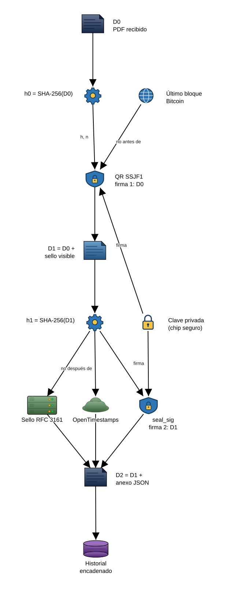
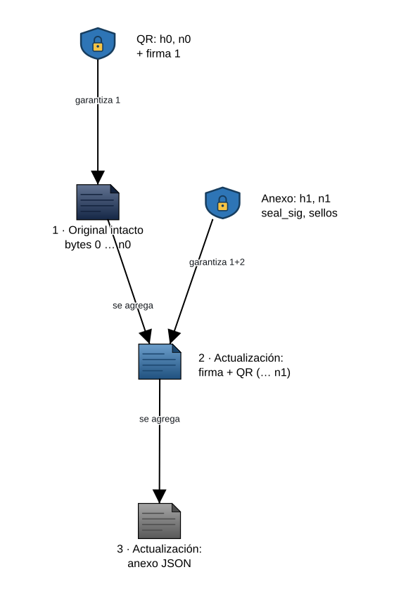
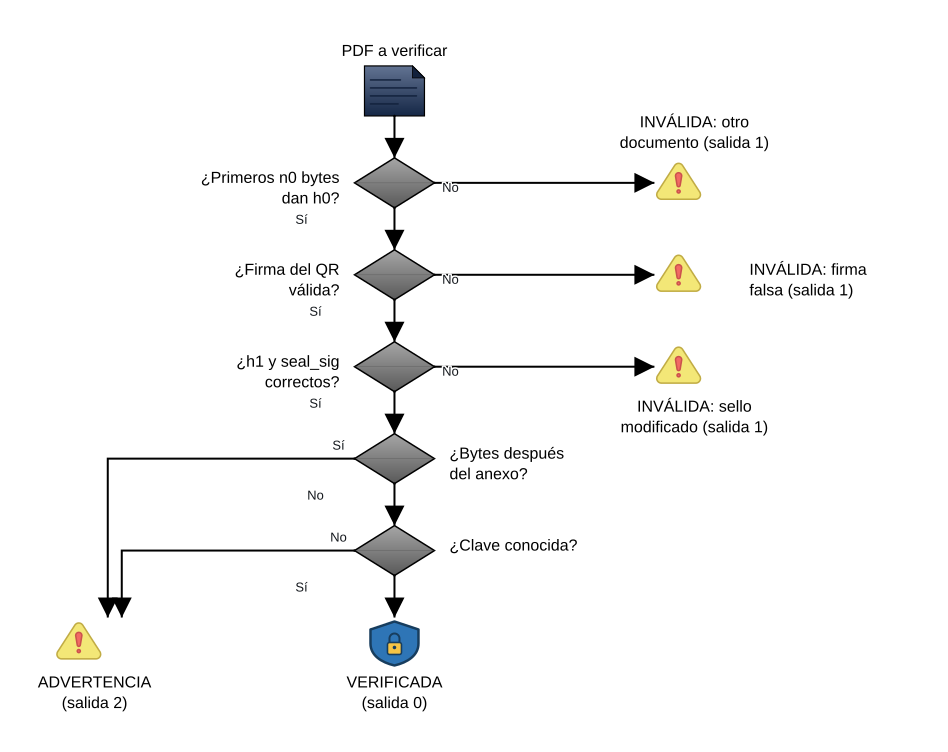
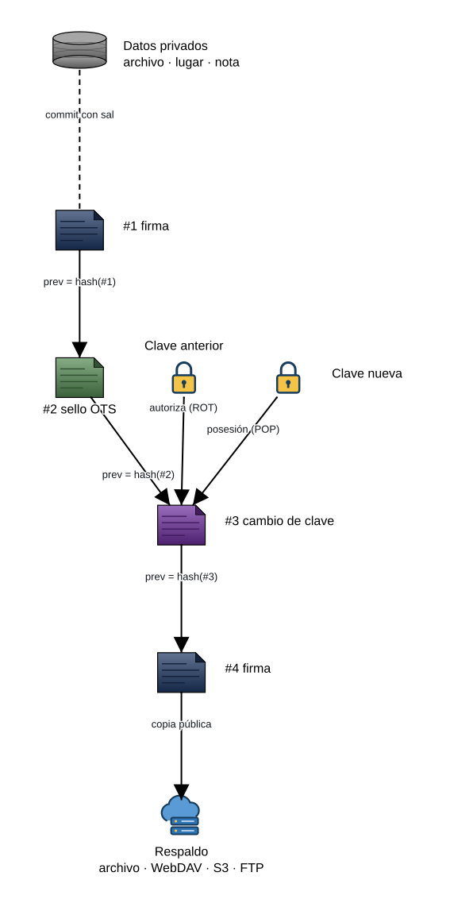

> **El estándar SSJF vive ahora en su propio repositorio: <https://github.com/Josexato/SSJF>.**
> Esta carpeta es una copia para las firmas hechas con versiones anteriores de Navaja.

# ¿Qué es el QR junto a esta firma?

*English summary below.*

Si llegaste aquí escaneando el QR de un documento firmado: ese QR es una
**firma verificable SSJF**. Permite comprobar matemáticamente **qué documento
se firmó, cuándo y con qué clave**, sin confiar en nadie y sin subir el
documento a ningún sitio.

El QR contiene:

| Campo | Qué es |
|---|---|
| `h` | Resumen SHA-256 del documento **tal como estaba antes de firmarlo** |
| `n` | Tamaño en bytes de ese documento |
| `t` | Hora de la firma (segundos Unix, UTC), declarada por quien firma |
| `b` | Altura y hash del último bloque de Bitcoin al firmar: prueba de que la firma **no se hizo antes** de ese momento |
| `r` | Revisión del formato: `2` exige una segunda firma sobre el PDF ya sellado (ver abajo) |
| `k` | Identificador de la clave pública de quien firmó |
| `s` | Firma digital ECDSA P-256 de todo lo anterior |

La parte antes de `#` es sólo esta página; el resto (el fragmento) no se envía
a ningún servidor al abrir el enlace.

## Cómo se firma

<p align="center"></p>

1. Se calcula el resumen `h0` del PDF **tal como llegó** y se firma junto con
   la hora y el último bloque de Bitcoin: eso es el QR (firma 1).
2. Se dibujan la firma manuscrita y el QR en una actualización al final del
   archivo (`D1`), y se firma también su resumen `h1` (firma 2, `seal_sig`).
3. Sólo `h1` viaja a los sellos de tiempo (RFC 3161 y OpenTimestamps).
4. Todo se guarda en un anexo al final (`D2`) y en el historial del firmante.

El original nunca se toca: queda byte a byte al inicio del archivo firmado.

<p align="center"></p>

## Qué prueba y qué no

- ✓ **Integridad**: si cambia un solo bit del documento firmado, el resumen no coincide.
- ✓ **Lo que se ve**: una segunda firma (en el anexo) avala el PDF ya sellado,
  así nadie puede reutilizar este QR con otra apariencia u otro contenido.
- ✓ **Autoría**: sólo quien tiene la clave privada (guardada en el chip seguro de su teléfono, no exportable) puede producir una firma válida para esa clave.
- ✓ **Tiempo**: no antes del bloque Bitcoin `b`; no después del sello RFC 3161 y de OpenTimestamps que van en el anexo del PDF.
- ✗ No identifica a la persona por sí sola: hay que saber que la clave `k` es suya (que te la haya compartido, o que la publique).
- ✗ No es una firma electrónica "calificada" en el sentido legal de ninguna jurisdicción; es una prueba técnica.

## Cómo verificar

<p align="center"></p>

### Con el PDF firmado

El PDF firmado contiene **el original intacto byte a byte al inicio**, más una
actualización incremental con la firma visible y un anexo JSON. Por eso:

```sh
# 1) El original es exactamente los primeros n bytes:
head -c <n> firmado.pdf | sha256sum      # debe dar h

# 2) Verificador completo (resúmenes, firma, cambios posteriores, extracción):
pip install cryptography
python3 verificar_ssjf.py firmado.pdf --extraer salida/
```

Código de salida: `0` verificada, `1` inválida, `2` válida con advertencias o
sin poder comprobarla (por ejemplo, sin `cryptography`). Para automatizar,
acepta sólo `0`.

[`verificar_ssjf.py`](verificar_ssjf.py) es un script de un solo archivo, sin
dependencias de Navaja. También detecta si **alguien agregó cambios después de
la firma** (y extrae la versión que realmente se firmó).

### Con un papel impreso

Escanea el QR con la cámara y copia el texto:

```sh
python3 verificar_ssjf.py --qr "<texto del QR>" --clave clave_del_firmante.json
python3 verificar_ssjf.py documento.pdf --qr "<texto del QR>"   # ¿este archivo es el que se firmó?
```

### Si quien firma cambió de clave

Cuando alguien cambia de clave (o de teléfono), publica una **declaración de
cambio de clave** firmada con la clave anterior. Si confías en la anterior,
puedes confiar en la nueva:

```sh
python3 verificar_ssjf.py firmado.pdf --clave clave_anterior.json --cambio cambio_clave.json
```

### Los sellos de tiempo del anexo

```sh
python3 verificar_ssjf.py firmado.pdf --extraer salida/
# RFC 3161 (FreeTSA u otra autoridad):
openssl ts -verify -digest <h1> -in salida/firma1.tsr -CAfile cacert.pem -untrusted tsa.crt
# OpenTimestamps (anclado en Bitcoin, sin confiar en nadie):
pip install opentimestamps-client
ots upgrade salida/firma1.ots && ots verify -d <h1> salida/firma1.ots
```

`h1` es el resumen del PDF ya sellado (está en el anexo). Los certificados de
FreeTSA están en <https://freetsa.org/index_en.php>.

## Quien firma tiene un historial

<p align="center"></p>

La app que firma (por ejemplo [Navaja](https://github.com/Josexato/navaja), app Android) guarda un **historial
encadenado** de todas sus firmas: cada entrada incluye el resumen de la
anterior, así que no se puede borrar ni insertar una firma sin que se note.
Con él, quien firma puede responder a "¿firmaste esto?":

| Resultado | Significado |
|---|---|
| ✓ Firmado por ti | Firma válida, con su clave y registrada en su historial |
| ⚠ Tuya pero no registrada | Firma válida con su clave que no aparece en su historial |
| ✗ Firma falsa | El QR fue alterado o fabricado |
| ✗ Otro documento | El QR existe, pero corresponde a otro documento |
| ⚠ Cambios posteriores | La firma es válida, pero se agregó contenido después; se puede extraer lo firmado |

Los datos privados de cada firma (nombre del archivo, lugar, comentario)
**nunca van en el PDF**: sólo en ese historial, y en los respaldos públicos
sólo como un compromiso con sal (un resumen que permite demostrarlos después
sin revelarlos).

## Ejemplo

[`ejemplos/ejemplo_firmado.pdf`](ejemplos/ejemplo_firmado.pdf) es un PDF de prueba firmado con anclas reales (bloque Bitcoin, FreeTSA, OpenTimestamps). La firma dibujada es sintética.

```sh
python3 verificar_ssjf.py ejemplos/ejemplo_firmado.pdf --extraer salida/
```

## Especificación

El formato es abierto y cualquiera puede implementarlo:
[**SSJF_v1.md**](SSJF_v1.md).

---

## English summary

The QR next to the handwritten signature is an **SSJF v1** verifiable
signature: `h` = SHA-256 of the document before signing, `n` = its length,
`t` = Unix time, `b` = latest Bitcoin block (proves *not before*), `k` = key
id, `s` = ECDSA P-256/SHA-256 signature (raw r‖s, base64url) over the UTF-8
bytes from `SSJF1` up to (excluding) `;s=`. The signed PDF begins with the
original file byte-for-byte (`head -c n signed.pdf | sha256sum` = `h`), followed
by an incremental update with the visible stamp and a JSON annex carrying the
post-stamp hash and RFC 3161 / OpenTimestamps proofs (*not after*). Verify
with [`verificar_ssjf.py`](verificar_ssjf.py). Full spec: [SSJF_v1.md](SSJF_v1.md).

## Diagramas

Hechos con [AlmaGag](https://github.com/Josexato/AlmaGag). La fuente editable
de cada uno está junto a su SVG en [`diagramas/`](diagramas/):

```sh
pip install -e git+https://github.com/Josexato/AlmaGag.git#egg=AlmaGag
almagag diagramas/01-firma.gag -o diagramas/01-firma.svg
```

## Pruebas

[`pruebas/`](pruebas/) tiene vectores reales generados por Navaja: una firma
válida, QR alterado, firma del sello alterada, QR reutilizado con otro sello,
firma del sello quitada, cambio posterior, formato 1.0 e historial (íntegro y
alterado). Se ejecutan en cada cambio:

```sh
pip install cryptography
python3 -m unittest discover -s pruebas -v
```

## Implementaciones

- [Navaja](https://github.com/Josexato/navaja) (Android, Java): firma con S Pen, clave en StrongBox/TEE, historial y respaldo. Código en `app/src/main/java/com/josexato/navaja/sign/core/`.
- [`verificar_ssjf.py`](verificar_ssjf.py): verificador de referencia en Python.

## Licencia

Especificación y código bajo licencia MIT: cualquiera puede implementar, copiar y adaptar SSJF.
